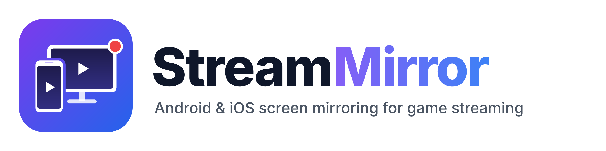

<p align="center">
  <picture>
    <source media="(prefers-color-scheme: dark)" srcset="assets/banner-dark.png">
    <source media="(prefers-color-scheme: light)" srcset="assets/banner-light.png">
    
  </picture>
</p>

<p align="center">
  <b>Android &amp; iOS screen mirroring for game streaming, with the game audio kept separate from your microphone.</b>
</p>

---

## About

StreamMirror is a Windows desktop app that mirrors a phone screen and its game audio to the PC, so a mobile game can be streamed through OBS.

It was built to fix one specific problem: tools that pick up "game audio" through the phone's microphone also pick up your own voice, so you hear yourself twice. StreamMirror only ever requests the phone's **digital audio output**. It never opens the phone microphone. Your voice stays on the PC microphone (OBS, Discord), and the two never mix.

The interface is currently in Indonesian.

## Status

| Path | State |
|---|---|
| Android over USB | Tested on a Samsung Galaxy A56 (Android 16) |
| Android over Wi-Fi | Tested on the same phone |
| iPhone / iPad over AirPlay | Receiver starts and is advertised on the network; **not yet tested with a real iPhone** |
| iPhone / iPad over USB | Helper builds and runs; **not yet tested with a real iPhone**, experimental |

Windows 10/11 x64 only. Mirroring is view-only: the phone cannot be controlled from the PC.

## Features

- **Android over USB or Wi-Fi** through `adb` and the official [scrcpy](https://github.com/Genymobile/scrcpy) server 5.0.1. Nothing is installed on the phone.
- **Clean game audio.** Audio is captured digitally on the phone (Android 11+), so the phone microphone is never involved. The phone speaker is muted while mirroring; an option keeps it playing on the phone as well (Android 13+).
- **Selectable audio output.** Send the phone audio to any Windows output device, for example a dedicated Voicemeeter strip, with its own volume and mute.
- **OBS-ready window.** Each phone gets a window that contains only the picture, titled `Mirror - <device name>`, and keeps rendering while it is covered by other windows.
- **iPhone / iPad over AirPlay**, using [UxPlay](https://github.com/FDH2/UxPlay) as a separate receiver process. No app on the iPhone.
- **iPhone / iPad over USB** (experimental), using the QuickTime capture protocol through a per-device libusb0 filter driver.
- **Adjustable video**: maximum resolution (native, 2560, 1920, 1600, 1280), bitrate 2–40 Mbps, and 30/60/90/120 FPS.
- **Dark and light themes.**

## Requirements

- Windows 10 or 11, 64-bit
- [Node.js](https://nodejs.org) 22.12 or newer, and Git
- Android: USB debugging enabled. Audio needs Android 11 or newer.
- iPhone / iPad: Apple's Bonjour and USB support, which come with **Apple Devices** (Microsoft Store) or iTunes

## Download

Get the portable Windows build from [Releases](https://github.com/Xaneqt/StreamMirror/releases): download `StreamMirror-<version>-win64.zip`, extract the whole folder, and run `StreamMirror.exe`. Nothing is installed. The build is not code-signed, so Windows SmartScreen may warn the first time; choose **More info → Run anyway**.

The download already contains `adb`, the scrcpy server, the AirPlay receiver, and the iPhone USB helper.

## Build from source

```bash
git clone https://github.com/Xaneqt/StreamMirror.git
cd StreamMirror
npm install
npm run fetch:android   # downloads scrcpy-server 5.0.1 and adb (checksums verified)
npm run dev
```

That is enough for Android. The iPhone paths need native helpers, built once:

```bash
npm run build:airplay   # AirPlay receiver (UxPlay)
npm run build:usb       # iPhone USB capture helper
```

Both commands download a private MSYS2 toolchain into `<drive>:\mh-work` (about 2 GB, outside the project folder) and do not install anything system-wide. Set the `MH_WORK` environment variable to use a different folder.

To produce a portable build in `dist\StreamMirror-win32-x64\`:

```bash
npm run package
```

### Scripts

| Command | Purpose |
|---|---|
| `npm run dev` | Run the app in development mode |
| `npm run typecheck` | Type-check the project |
| `npm test` | Run the unit tests |
| `npm run fetch:android` | Download the Android runtime (`scrcpy-server`, `adb`) into `resources/` |
| `npm run build:airplay` | Build the AirPlay receiver into `resources/airplay/` |
| `npm run build:usb` | Build the iPhone USB helper into `resources/usb/` |
| `npm run package` | Build the portable Windows package into `dist/` |

## Usage

### Android

1. On the phone, enable **Developer options**, then **USB debugging**.
2. Connect the phone with a data cable and accept **Allow USB debugging**.
3. The phone appears in the **Android** block. Click **Mirror**.

For Wi-Fi, click **Jadikan wireless** while the phone is connected over USB, then unplug the cable. Alternatively, use the **Pair** and **Connect** fields with the address and code shown under *Wireless debugging* on the phone.

### iPhone / iPad over AirPlay

1. Put the iPhone and the PC on the same network.
2. On the iPhone, open **Control Center → Screen Mirroring → StreamMirror**.

If the iPhone lists StreamMirror but cannot connect, allow the receiver through Windows Firewall from an elevated PowerShell:

```powershell
New-NetFirewallRule -DisplayName "StreamMirror AirPlay" -Direction Inbound -Program "<full path to uxplay.exe>" -Action Allow -Profile Private -Protocol Any
```

AirPlay also works over a cable: connect the iPhone, turn on **Personal Hotspot**, and start Screen Mirroring as above.

### iPhone / iPad over USB (experimental)

1. Connect the iPhone and tap **Trust**.
2. Click **Pasang driver USB**. This asks for administrator rights and adds the libusb-win32 1.4.0.2 filter driver to that one iPhone only. If Windows refuses the driver, for example because Memory Integrity is on, the filter is removed again automatically.
3. Click **Mirror via USB**.

**Lepas driver USB** removes the filter.

### Audio

The **Output** list chooses which Windows device plays the phone audio. Leave **Tetap bunyi di HP** unticked to hear the game on the PC only; ticking it plays the audio on the phone speaker as well.

### Streaming with OBS

1. Start mirroring so the `Mirror - <device name>` window is open.
2. Add a **Window Capture** source and select that window.
3. For audio, add an **Application Audio Capture** source for the same window, or route StreamMirror's output to a device OBS already captures.

## Uninstall

StreamMirror is portable, so removing it is manual:

1. If you set up iPhone USB capture, click **Lepas driver USB** for that iPhone first. This removes the libusb0 filter driver.
2. If you added the AirPlay firewall rule, remove it from an elevated PowerShell: `Remove-NetFirewallRule -DisplayName "StreamMirror AirPlay"`.
3. Delete the extracted `StreamMirror-win32-x64` folder.
4. Delete the settings folder `%APPDATA%\StreamMirror`.

## Privacy

This program will not transfer any information to other networked systems unless specifically requested by the user or the person installing or operating it.

StreamMirror talks only to the phone you connect: over USB, over `adb` on your local network, or by accepting AirPlay connections on your local network while it is running. It does not download anything at runtime and has no telemetry.

## Project layout

| Path | Contents |
|---|---|
| `src/main/` | Electron main process: adb, scrcpy session, AirPlay receiver, iPhone USB session, window registry |
| `src/renderer/` | Launcher UI and the mirror window (WebCodecs video, Web Audio) |
| `src/shared/` | Types and IPC channel list shared by both sides |
| `scripts/` | Download, native build, and packaging scripts |
| `native/` | Sources for the native helpers (GPL-3.0-or-later, from Mirrorlab) |
| `assets/` | Logo and banner |

## Code signing policy

Free code signing provided by [SignPath.io](https://about.signpath.io), certificate by [SignPath Foundation](https://signpath.org).

- Committers and reviewers: [Xaneqt](https://github.com/Xaneqt)
- Approvers: [Xaneqt](https://github.com/Xaneqt)

Release builds are produced by the [Release workflow](.github/workflows/release.yml) on GitHub-hosted runners, and every signing request is approved manually. Only `StreamMirror.exe` is signed; the bundled third-party programs (`adb.exe`, `uxplay.exe`, `iphone-usb.exe`) are included unsigned. See [Privacy](#privacy) for what the program sends over the network.

## License

StreamMirror is free software, licensed under the [GNU General Public License v3.0 or later](LICENSE) (`GPL-3.0-or-later`).

Third-party components keep their own licenses; parts of two build scripts are ported from an Apache-2.0 project. See [NOTICE.md](NOTICE.md) and the texts in [LICENSES/](LICENSES). The release package also includes the corresponding source of its bundled GPL programs under `resources/airplay/source/` and `resources/usb/source/`.

## Acknowledgements

- [scrcpy](https://github.com/Genymobile/scrcpy) by Genymobile: the Android server that does the capture
- [UxPlay](https://github.com/FDH2/UxPlay): the AirPlay receiver
- [iPhoneMirror](https://github.com/RayrenSX/iPhoneMirror): the iPhone USB capture protocol and transport
- [Mirrorlab](https://github.com/SimonDaBoss/mirrorlab): the native bridge, USB helper, and build scripts this project ports
- [libusb-win32](https://github.com/mcuee/libusb-win32): the USB filter driver

---

<sub>StreamMirror is an independent project and is not affiliated with Google, Apple, or Genymobile. Android is a trademark of Google LLC. iPhone, iPad, and AirPlay are trademarks of Apple Inc.</sub>
